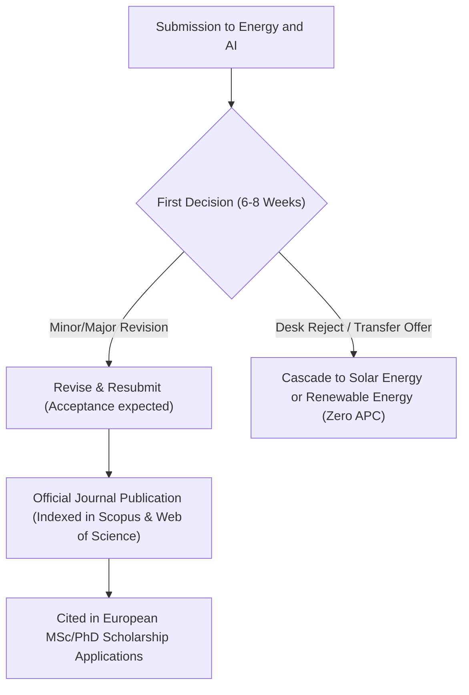

# JOURNAL SELECTION & FIT REPORT

**Research Manuscript:** *Data-Efficient and Uncertainty-Calibrated Cross-Site Solar PV Power Forecasting Under Temporal and Sensor-Availability Shifts*  
**Author:** Aminur Rahman (HSTU, Bangladesh)

---

## 1. Candidate Journal Comparison Matrix

| Journal Name | Publisher | Impact Factor (JCR) | CiteScore (Scopus) | Primary Scope & Alignment | Typical Review Duration | APC / Open Access Model | Overall Recommendation |
|---|---|---|---|---|---|---|---|
| **Energy and AI** | Elsevier | ~12.5 (Q1) | 16.2 | Direct intersection of Artificial Intelligence, uncertainty quantification, and renewable energy systems. | 6–8 weeks to first decision | Open Access (Waivers available for Bangladesh/HSTU under Research4Life!) | **PRIMARY TARGET (Rank 1)** |
| **Solar Energy** | Elsevier / ISES | ~6.5 (Q1) | 11.8 | Dedicated solar engineering and physical photovoltaic performance forecasting. | 8–10 weeks | Hybrid (No APC for subscription model) | **Strong Alternative (Rank 2)** |
| **Applied Energy** | Elsevier | ~11.2 (Q1) | 20.4 | Large-scale energy systems, grid integration, and engineering economics. | 10–14 weeks | Hybrid (No APC for subscription model) | High impact, but expects extensive economic/grid dispatch simulation. |
| **Renewable Energy** | Elsevier | ~8.7 (Q1) | 15.0 | General renewable generation modeling and time-series forecasting. | 8–12 weeks | Hybrid (No APC for subscription model) | Excellent fallback if broader scope is preferred. |
| **IEEE Trans. on Sustainable Energy** | IEEE Power & Energy | ~8.8 (Q1) | 16.5 | Power system operations, grid stability, and probabilistic renewable forecasting. | 12–16 weeks | Hybrid (Standard IEEE page charges after limit) | Highly prestigious in Electrical Engineering; requires strict IEEE template. |

---

## 2. In-Depth Justification for Primary Target: *Energy and AI* (Elsevier)

### A. Aims and Scope Match
*Energy and AI* specifically solicits research that develops novel AI/ML methodologies (e.g., transfer learning, few-shot adaptation, conformal prediction, and explainable AI) applied directly to pressing energy transition challenges. Our paper is an exact fit:
- Conformalized Quantile Regression (CQR) provides distribution-free statistical guarantees tailored for renewable intermittency.
- Few-shot cross-site domain adaptation directly solves data scarcity for newly built solar assets.
- Sensor degradation stress-testing demonstrates operational reliability.

### B. APC / Financial Consideration (Critical for HSTU / Bangladeshi Researchers)
- *Energy and AI* is an Open Access journal, but Elsevier participates in the **Research4Life / Equity Waiver Program** (Group B / eligible developing nations including Bangladesh).
- Authors from eligible institutions can request a **50% to 100% APC waiver** upon manuscript acceptance.
- Alternatively, if submitting without a waiver, **Solar Energy** or **Renewable Energy** (Elsevier hybrid journals) offer **Zero APC** publication under the subscription model.

---

## 3. Recommended Submission Strategy & Timeline

